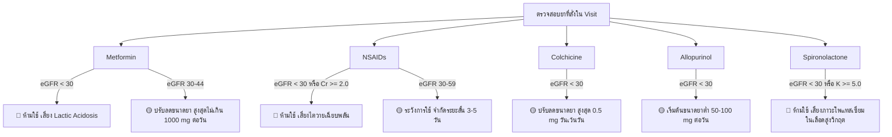
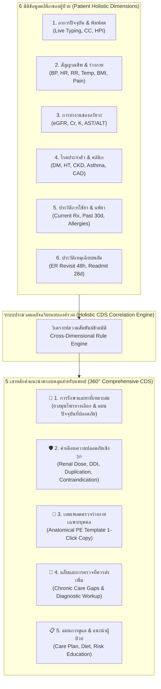

# คู่มือมาตรฐานและเงื่อนไขทางคลินิก (Clinical Decision Support Specification & Knowledge Base)
## ระบบผู้ช่วยแพทย์ OPD Doctor Assistant (โรงพยาบาลแม่ทะ)

> **ฉบับปรับปรุง:** พฤศจิกายน 2569 (Build 20261108.03)  
> **วัตถุประสงค์:** เอกสารอ้างอิงเงื่อนไข สูตรการคำนวณ แหล่งข้อมูลจากฐานข้อมูล HOSxP (MariaDB) และเกณฑ์สากลทางการแพทย์ เพื่อใช้เป็นคู่มือสำหรับบุคลากรทางการแพทย์ นักพัฒนาระบบ และเป็นฐานความรู้สำหรับ Local AI ในการเรียนรู้และปรับปรุงระบบในอนาคต

---

## สารบัญ
1. [สถาปัตยกรรมระบบและความปลอดภัยข้อมูล (System Architecture & Data Privacy)](#1-สถาปัตยกรรมระบบและความปลอดภัยข้อมูล)
2. [พจนานุกรมตารางและฟิลด์ HOSxP ที่ใช้งาน (HOSxP Schema & Field Mapping)](#2-พจนานุกรมตารางและฟิลด์-hosxp-ที่ใช้งาน)
3. [ระบบประเมินการทำงานของไตและสูตรคำนวณ (Renal Function Evaluation & GFR Formulas)](#3-ระบบประเมินการทำงานของไตและสูตรคำนวณ)
4. [ระบบติดตามสิ่งตกค้างในโรคเรื้อรัง (Chronic Care Gap CDS & uACR Analysis)](#4-ระบบติดตามสิ่งตกค้างในโรคเรื้อรัง)
5. [ระบบความปลอดภัยด้านยา การปรับขนาดยา และยาซ้ำซ้อน (Medication Safety, Renal Dosing, DDI & Duplication)](#5-ระบบความปลอดภัยด้านยา-การปรับขนาดยา-และยาซ้ำซ้อน)
6. [ระบบคัดกรองภาวะวิกฤตเฉียบพลัน (Critical Clinical Alerts: Sepsis & Dengue)](#6-ระบบคัดกรองภาวะวิกฤตเฉียบพลัน)
7. [ระบบเฝ้าระวังผู้ป่วยกลับมาตรวจซ้ำ (ER Revisit & Hospital Readmission)](#7-ระบบเฝ้าระวังผู้ป่วยกลับมาตรวจซ้ำ)
8. [ระบบการแพทย์แผนไทย สมุนไพร และการดักจับข้อความพิมพ์สด (Herbal, Physical Care & Real-Time Live Typing CDS)](#8-ระบบการแพทย์แผนไทย-สมุนไพร-และการดักจับข้อความพิมพ์สด)
9. [สถาปัตยกรรมระบบอัจฉริยะวิเคราะห์ประวัติแบบองค์รวม 360 องศา (Holistic Multi-Modal CDS Framework)](#9-สถาปัตยกรรมระบบอัจฉริยะวิเคราะห์ประวัติแบบองค์รวม-360-องศา)
10. [แนวทางการนำไปใช้งานและต่อยอดกับ Local AI (Local LLM Context Guide)](#10-แนวทางการนำไปใช้งานและต่อยอดกับ-local-ai)

---

## 1. สถาปัตยกรรมระบบและความปลอดภัยข้อมูล

### 1.1 สถาปัตยกรรมแบบ Zero-Write (Read-Only Safety)
- **การเชื่อมต่อฐานข้อมูล HOSxP:** เชื่อมต่อแบบ **อ่านอย่างเดียว (Read-Only MySQL/MariaDB User)** ผ่านพอร์ต 3306 
- **ไม่มีการแก้ไขข้อมูลใน HOSxP:** ระบบทำงานเป็น "จอคู่ขนาน (Sidebar Companion)" จะไม่มีคำสั่ง `INSERT`, `UPDATE`, `DELETE`, `ALTER`, หรือ `DROP` ไปยังฐานข้อมูล HOSxP โรงพยาบาลโดยเด็ดขาด
- **Audit Logging:** บันทึกประวัติการเรียกดูข้อมูลผู้ป่วย (HN, VN, IP เครื่อง, ชื่อผู้ใช้งาน, วันเวลา) ลงใน SQLite ภายในเครื่องเซิร์ฟเวอร์ตาม พ.ร.บ. คุ้มครองข้อมูลส่วนบุคคล (PDPA)

### 1.2 วัตถุประสงค์ของ Clinical Decision Support (CDS)
- ไม่ได้มีไว้เพื่อสั่งการรักษาแทนแพทย์ (Non-Autonomous)
- ทำหน้าที่เป็น **ตาคู่ที่สอง (Second Pair of Eyes / Clinical Guardrail)** แจ้งเตือนความปลอดภัย ป้องกันความผิดพลาดทางยา (Medication Error) และลดช่องว่างการดูแล (Care Gap) ตามมาตรฐานระดับสากล

---

## 2. พจนานุกรมตารางและฟิลด์ HOSxP ที่ใช้งาน

| ตาราง (Table) | ฟิลด์สำคัญ (Fields) | ความหมายและการนำไปใช้ในระบบ |
| :--- | :--- | :--- |
| `patient` | `hn`, `fname`, `lname`, `birthday`, `sex`, `bloodgrp`, `drugallergy` | ข้อมูลพื้นฐานผู้ป่วย เพศ อายุ วันเกิด ประวัติแพ้ยา |
| `ovst` | `vn`, `hn`, `an`, `vstdate`, `vsttime`, `cur_dep`, `spclty`, `oqueue`, `doctor` | ข้อมูลการมารับบริการ แผนก คิวตรวจ แพทย์ผู้ตรวจ |
| `opdscreen` | `bps`, `bpd`, `pulse`, `rr`, `temperature`, `bw`, `height`, `bmi`, `cc`, `hpi`, `pe`, `fbs` | สัญญาณชีพ อาการสำคัญ ประวัติปัจจุบัน การตรวจร่างกาย |
| `ovstdiag` | `vn`, `hn`, `icd10`, `diagtype`, `modify_datetime` | การวินิจฉัยโรค รหัส ICD-10 (`diagtype`: 1=Principal, 2=Comorbidity) |
| `opitemrece` | `vn`, `hn`, `an`, `icode`, `qty`, `unitprice`, `drugusage`, `vstdate` | รายการยา ค่าบริการ เวชภัณฑ์ที่ได้รับใน Visit |
| `drugitems` | `icode`, `name`, `strength`, `units`, `generic_name`, `did` | บัญชียา รหัสยา ความแรง ขนาดบรรจุ |
| `drugusage` | `drugusage`, `name1`, `name2`, `name3`, `shortlist` | วิธีใช้ยา รอบเวลาการรับประทานยา |
| `lab_head` | `lab_order_number`, `vn`, `hn`, `order_date`, `order_time`, `form_name` | ใบสั่งตรวจทางห้องปฏิบัติการ วันเวลาสั่งตรวจ |
| `lab_order` | `lab_order_number`, `lab_items_code`, `lab_order_result`, `abnormal_result`, `critical_result` | ผลแล็บ ค่าอ้างอิง สถานะผิดปกติ/วิกฤต |
| `lab_items` | `lab_items_code`, `lab_items_name`, `lab_items_unit`, `lab_items_normal_value` | พจนานุกรมรายการแล็บ หน่วยตรวจ ค่าปกติ |
| `clinicmember` | `hn`, `clinic`, `begin_date`, `dchdate` | ทะเบียนคลินิกโรคเรื้อรัง (`001`=เบาหวาน, `002`=ความดันโลหิตสูง) |
| `ipt` | `an`, `hn`, `vn`, `regdate`, `regtime`, `dchdate`, `dchtime`, `dchstts`, `ward` | ข้อมูลการนอนโรงพยาบาล วันจำหน่าย วอร์ด |
| `er_regist` | `vn`, `er_emergency_type`, `finish_time` | ทะเบียนการเข้ารับบริการที่ห้องฉุกเฉิน (ER) |

---

## 3. ระบบประเมินการทำงานของไตและสูตรคำนวณ

### 3.1 สูตรการคำนวณ eGFR: CKD-EPI 2021 (Refit Without Race)
อ้างอิงตามสมาคมโรคไตแห่งประเทศไทยและมาตรฐาน KDIGO 2024 โดยไม่ใช้ตัวคูณเชื้อชาติ (Race-Free Equation):

$$\text{eGFR} = 142 \times \min\left(\frac{S_{cr}}{\kappa}, 1\right)^\alpha \times \max\left(\frac{S_{cr}}{\kappa}, 1\right)^{-1.200} \times 0.9938^{\text{Age}} \times [1.012 \text{ if Female}]$$

* **เพศหญิง ($\text{Female}$):** $\kappa = 0.7$, $\alpha = -0.241$
* **เพศชาย ($\text{Male}$):** $\kappa = 0.9$, $\alpha = -0.302$
* **$S_{cr}$:** Serum Creatinine (mg/dL) จาก HOSxP (ดึงจาก `opdscreen.cr` หรือ `lab_order` รหัสแล็บ `155`)
* **$\text{Age}$:** อายุผู้ป่วย ณ วันที่มารับบริการ (คำนวณจาก `patient.birthday` เทียบกับ `ovst.vstdate`)

### 3.2 สูตรการคำนวณ CrCl: Cockcroft-Gault Equation
ใช้สำหรับการปรับขนาดยาตามคำแนะนำในฉลากยา (FDA / Renal Drug Dosing Guideline):

$$\text{CrCl (mL/min)} = \frac{(140 - \text{Age}) \times \text{Weight (kg)}}{72 \times S_{cr}} \times [0.85 \text{ if Female}]$$

* **$\text{Weight}$:** น้ำหนักตัวจริง (kg) จาก `opdscreen.bw`

### 3.3 การจัดแบ่งระยะโรคไตเรื้อรัง (KDIGO 2024 vs HOSxP)
| ระดับ eGFR (mL/min/1.73m²) | นิยาม KDIGO | ระดับใน HOSxP | ความหมายทางคลินิก |
| :--- | :--- | :--- | :--- |
| $\ge 90$ | Category G1 | Stage 1 | ปกติ หรือ ไตทำงานปกติแต่มีพยาธิสภาพร่วม |
| $60 - 89$ | Category G2 | Stage 2 | การทำงานของไตลดลงเล็กน้อย (Mild) |
| $45 - 59$ | Category G3a | Stage 3 | การทำงานของไตลดลงปานกลาง (Mild to Moderate) |
| $30 - 44$ | Category G3b | Stage 3 | การทำงานของไตลดลงปานกลางถึงมาก (Moderate to Severe) |
| $15 - 29$ | Category G4 | Stage 4 | การทำงานของไตลดลงอย่างรุนแรง (Severe CKD) |
| $< 15$ | Category G5 | Stage 5 | ไตวายระยะสุดท้าย (Kidney Failure / ESRD) |

---

## 4. ระบบติดตามสิ่งตกค้างในโรคเรื้อรัง (Chronic Care Gap CDS)

### 4.1 เกณฑ์การประเมินและการดึงข้อมูลจาก HOSxP

| รายการแล็บ (Lab Item) | กลุ่มเป้าหมาย (Target Population) | เกณฑ์เวลา (Interval) | รหัสแล็บใน HOSxP (Lab Codes) | เกณฑ์แจ้งเตือน (Alert Rule) |
| :--- | :--- | :--- | :--- | :--- |
| **HbA1c (น้ำตาลสะสม)** | ผู้ป่วยเบาหวาน (DM: `clinicmember.clinic = '001'` หรือ ICD-10 `E10-E14`) | ทุก 6 เดือน (180 วัน) | `185` หรือ `lab_items_name LIKE '%a1c%'` | • ไม่พบประวัติตรวจเลย<br>• ตรวจล่าสุดเกิน 180 วัน |
| **LDL-C (ไขมันเลว)** | ผู้ป่วยเบาหวานหรือความดันโลหิตสูง (DM หรือ HT: `clinicmember` 001/002 หรือ ICD-10 `E10-E14`, `I10`) | ทุก 1 ปี (365 วัน) | `160` (LDL-Cholesterol)<br>`1886` (LDL Direct) | • ไม่พบประวัติตรวจเลย<br>• ตรวจล่าสุดเกิน 365 วัน |
| **Creatinine / eGFR** | ผู้ป่วยเบาหวาน, ความดัน, หรือไตเสื่อม (DM, HT, หรือ CKD: eGFR < 60 หรือ ICD-10 `N18`) | ทุก 1 ปี (365 วัน) | `155` (Creatinine) | • ไม่พบประวัติตรวจเลย<br>• ตรวจล่าสุดเกิน 365 วัน |
| **uACR (ไข่ขาวรั่วในปัสสาวะ)** | ผู้ป่วยเบาหวาน, ความดัน, หรือ CKD (DM, HT, CKD) | ทุก 1 ปี (365 วัน) | `1985` (uACR)<br>`199` (Urine Microalbumin)<br>*(Fallback: `100` Albumin UA)* | • ไม่พบประวัติตรวจเลย<br>• ตรวจล่าสุดเกิน 365 วัน |
| **Potassium (K)** | ผู้ป่วยไตวายขั้นรุนแรง (CKD Stage 4–5: eGFR < 30 mL/min) | ทุก 6 เดือน (180 วัน) | `173` (Potassium) | • ไม่พบประวัติตรวจในรอบ 180 วัน (เสี่ยง Hyperkalemia) |

---

### 4.2 ทำความเข้าใจ "uACR" และสาเหตุที่ผู้ป่วยส่วนใหญ่ไม่มีประวัติตรวจ

#### 1. uACR คืออะไร?
**uACR ย่อมาจาก Urine Albumin-to-Creatinine Ratio** คือการตรวจหาอัตราส่วนของโปรตีนแอลบูมิน (Albumin) ต่อครีอะตินีน (Creatinine) ในปัสสาวะ เพื่อตรวจหา **"ภาวะไข่ขาวรั่วในปัสสาวะระยะเริ่มต้น (Microalbuminuria)"**
- ตามแนวทางเวชปฏิบัติสากล (ADA Diabetes Guidelines และ KDIGO 2024 CKD Guideline) กำหนดให้ผู้ป่วยเบาหวานและความดันโลหิตสูงทุกคนต้องได้รับการตรวจ uACR อย่างน้อย **ปีละ 1 ครั้ง** เพื่อประเมินความเสื่อมของไตระยะแรกสุดก่อนที่ค่า eGFR ในเลือดจะเริ่มลดลง

#### 2. เกณฑ์การแปลผล uACR (KDIGO Albuminuria Categories):
* **Category A1 (ปกติถึงรั่วเล็กน้อย):** $< 30 \text{ mg/g}$
* **Category A2 (ไข่ขาวรั่วปานกลาง / Microalbuminuria):** $30 - 300 \text{ mg/g}$
* **Category A3 (ไข่ขาวรั่วรุนแรง / Macroalbuminuria / Overt Nephropathy):** $> 300 \text{ mg/g}$

#### 3. ทำไมผู้ป่วยในโรงพยาบาลชุมชนส่วนใหญ่ถึงไม่มีประวัติการตรวจ uACR?
จากการสำรวจข้อมูลในฐานข้อมูล HOSxP รพ.แม่ทะ พบว่า:
1. **ข้อจำกัดด้านงบประมาณและน้ำยาตรวจ:** การตรวจ uACR เชิงปริมาณ (Quantitative uACR รหัสแล็บ `1985`) มีต้นทุนน้ำยาสูง โรงพยาบาลชุมชนมักไม่ได้เปิดตรวจเป็นรูทีนทุกวัน
2. **การคัดกรองด้วย Urine Dipstick แทน:** ในการตรวจสุขภาพประจำปีของคลินิก NCD โรงพยาบาลมักใช้การตรวจ **Urine Albumin จาก Routine Urinalysis (UA แถบตรวจปัสสาวะ รหัสแล็บ `100`)** ซึ่งตรวจพบโปรตีนในระดับ Macroalbuminuria (Positive 1+, 2+, 3+) แต่มีความไวต่ำ ไม่สามารถตรวจจับ Microalbuminuria ในระยะเริ่มต้นได้

#### 4. กลไก Smart Fallback ในระบบ Assistant:
เพื่อแก้ปัญหาดังกล่าว ระบบ Assistant จึงมีระบบ Fallback 3 ชั้น:
1. ค้นหาผลตรวจ **uACR** (`1985`) เชิงปริมาณโดยตรงก่อน
2. หากไม่พบ ให้ค้นหาผล **Urine Microalbumin** (`199`)
3. หากไม่พบทั้งสองตัว ระบบจะค้นหาผลตรวจ **Albumin(UA)** (`100`) จากการตรวจปัสสาวะทั่วไปล่าสุดในรอบ 1 ปี:
   - หากผลเป็น **Negative หรือ Trace**: ระบบจะแสดงว่าตรวจแล้ว พร้อมแนะนำว่า *"ผล UA ล่าสุด Negative/Trace (ยังไม่เคยตรวจ uACR เชิงปริมาณ)"*
   - หากผลเป็น **Positive (1+ ขึ้นไป)**: ระบบจะขึ้นเตือนสีส้มทันทีว่า *"พบโปรตีนรั่วในปัสสาวะ (UA: Positive) ควรตรวจยืนยันด้วย uACR"*

---

## 5. ระบบความปลอดภัยด้านยา การปรับขนาดยา และยาซ้ำซ้อน

### 5.1 เกณฑ์การปรับขนาดยาตามการทำงานของไต (Renal Dose Adjustments)
ระบบจะตรวจสอบรายการยาที่แพทย์สั่งใน Visit นั้น (`opitemrece`) ร่วมกับค่าการทำงานของไตล่าสุด (`eGFR` และ `Cr`):



### 5.2 การแจ้งเตือนอันตรกิริยาระหว่างยาที่รุนแรง (Severe Drug-Drug Interactions: DDI)
1. **Warfarin + NSAIDs / Tramadol / Aspirin:**  
   - ระดับความรุนแรง: 🔴 **Major Clinical Hazard (เสี่ยงเลือดออกในทางเดินอาหารรุนแรง)**
   - ข้อความเตือน: *"ผู้ป่วยได้รับ Warfarin การสั่งยา NSAIDs/Tramadol เพิ่มความเสี่ยง Major GI Bleeding อย่างมีนัยสำคัญ ควรเลี่ยงไปใช้ Paracetamol หรือยาทาภายนอก"*
2. **ACEI + ARB (Dual RAAS Blockade):**  
   - เช่น Enalapril ร่วมกับ Losartan
   - ระดับความรุนแรง: 🔴 **Contraindicated Combination**
   - ข้อความเตือน: *"ห้ามใช้ยาในกลุ่ม ACEI ร่วมกับ ARB พร้อมกัน เนื่องจากเพิ่มความเสี่ยงต่อภาวะไตวายเฉียบพลัน (Acute Renal Failure) และโพแทสเซียมในเลือดสูงวิกฤต โดยไม่มีประโยชน์เสริมในการรักษา"*

### 5.3 การตรวจจับยาซ้ำซ้อน (Therapeutic Duplication Alert)
- ระบบจะดึงประวัติการรับยาในรอบ **30 วันย้อนหลัง** (`recentMeds30d`)
- หากพบว่าผู้ป่วยเพิ่งได้รับยาชนิดเดียวกันหรือกลุ่มเดียวกันไปไม่เกิน **20 วัน** และยังมียาเหลือที่บ้าน:
  - ระบบจะแจ้งเตือนแถบสีส้มแสดง: ชื่อยา, จำนวนเม็ดที่ได้รับไป, วันที่รับไป, และคำนวณจำนวนวันที่ผ่านมา

---

## 6. ระบบคัดกรองภาวะวิกฤตเฉียบพลัน (Critical Clinical Alerts)

### 6.1 เกณฑ์คัดกรองภาวะติดเชื้อในกระแสเลือด (Sepsis Screening)
ใช้เกณฑ์ **qSOFA Score (quick Sequential Organ Failure Assessment)** และ **SIRS Criteria**:
* อุณหภูมิกาย: $T \ge 38.0^\circ\text{C}$ หรือ $< 36.0^\circ\text{C}$
* อัตราการเต้นของหัวใจ: $\text{Pulse} > 90 \text{ bpm}$
* อัตราการหายใจ: $\text{RR} \ge 22 \text{ bpm}$ (qSOFA criteria)
* ความดันโลหิตตก: $\text{SBP} \le 100 \text{ mmHg}$ (qSOFA criteria)
* ผลแล็บยืนยัน: $\text{WBC} > 12,000$ หรือ $< 4,000 \text{ cells/mm}^3$ หรือ Band $> 10\%$

### 6.2 เกณฑ์เฝ้าระวังไข้เลือดออก (Dengue Hemorrhagic Fever Alert)
* อาการ: ไข้สูงเฉียบพลัน หน้าแดง ปวดเมื่อยตัว ปวดกระบอกตา
* ผลเลือด CBC:
  * เกล็ดเลือดต่ำ: $\text{Platelet} < 100,000 \text{ /mm}^3$ (เข้าสู่ระยะวิกฤต/รั่ว)
  * ความเข้มข้นเลือดสูงขึ้น: $\text{Hematocrit (Hct)} > 45\%$ (ในผู้ชาย) หรือ $> 42\%$ (ในผู้หญิง) หรือเพิ่มขึ้น $> 20\%$ จาก baseline
  * เม็ดเลือดขาวต่ำ: $\text{WBC} < 4,000 \text{ /mm}^3$
* **ข้อห้ามเด็ดขาด:** ห้ามสั่งยาในกลุ่ม NSAIDs (เช่น Ibuprofen, Diclofenac, Naproxen) และ Aspirin โดยเด็ดขาด เพราะเพิ่มความเสี่ยงเลือดออกในอวัยวะภายในจนเสียชีวิต

---

## 7. ระบบเฝ้าระวังผู้ป่วยกลับมาตรวจซ้ำ (ER Revisit & Hospital Readmission)

### 7.1 การกลับมาตรวจซ้ำที่ห้องฉุกเฉินภายใน 48 ชั่วโมง (ER Revisit within 48 Hours)
* **นิยามคุณภาพ (Quality Indicator):** ผู้ป่วยที่มารับบริการที่ห้องฉุกเฉิน และกลับมาตรวจซ้ำที่ห้องฉุกเฉินภายใน 48 ชั่วโมงด้วยอาการเดิมหรือภาวะแทรกซ้อน
* **แหล่งข้อมูล HOSxP:** ตรวจสอบ Visit ก่อนหน้าของผู้ป่วยจาก `ovst` และ `er_regist` ที่ `cur_dep IN ('011', '019')` หรือ `spclty = '03'`
* **สูตรคำนวณระยะห่างเวลาจริง:**
  $$\Delta t = (\text{Current Visit DateTime}) - (\text{Previous Visit DateTime})$$
  *(เปรียบเทียบจาก `vstdate` + `vsttime` ปัจจุบัน กับ Visit ก่อนหน้า เพื่อความถูกต้องแม่นยำ)*
* **การแสดงผล:** แสดงแบนเนอร์แจ้งเตือนสีแดงพร้อมระบุระยะห่างเวลาจริง เช่น *"กลับมาใน 8 ชม. 21 นาที"*, แผนกที่มา, และอาการที่มาในครั้งก่อน

### 7.2 การกลับเข้ารักษาตัวในโรงพยาบาลซ้ำภายใน 28 วัน (Hospital Readmission within 28 Days)
* **นิยามคุณภาพ:** ผู้ป่วยใน (IPD) ที่ได้รับการจำหน่าย (Discharge) และกลับมานอนโรงพยาบาลซ้ำภายใน 28 วัน
* **แหล่งข้อมูล HOSxP:** ตาราง `ipt` โดยตรวจสอบ `dchdate` ย้อนหลังไม่เกิน 28 วัน

---

## 8. ระบบการแพทย์แผนไทย สมุนไพร และการดักจับข้อความพิมพ์สด

### 8.1 กฎเหล็กความปลอดภัย (Strict Herbal Safety Suppression)
หากตรวจพบภาวะเสี่ยงข้อใดข้อหนึ่งต่อไปนี้ ระบบจะ **งดแนะนำยาสมุนไพรทุกชนิดทันที (Clean Suppression)** เพื่อความปลอดภัยสูงสุด:
1. **ผู้ป่วยได้รับยาวาร์ฟาริน หรือยาต้านการแข็งตัวของเลือด/เกล็ดเลือด** (`Warfarin`, `Rivaroxaban`, `Apixaban`, `Clopidogrel`): เสี่ยงอันตรกิริยาและเลือดออกง่าย
2. **ภาวะไตวายรุนแรง (CKD Stage 4–5):** `eGFR < 30 mL/min` หรือ `Cr >= 2.0 mg/dL`
3. **การทำงานของตับบกพร่องรุนแรง:** `AST` หรือ `ALT > 100 U/L`
4. **ผู้ป่วยตั้งครรภ์ (Pregnancy):** `patient.pregnancy = 'Y'` หรือระบุในอาการสำคัญ

---

### 8.2 การจับคู่อาการตามตำแหน่งกายวิภาค (Anatomical Clinical Decision Support)

| ตำแหน่งกายวิภาค / กลุ่มอาการ | คำค้นในอาการสำคัญ (CC / HPI) หรือ ICD-10 | ยาสมุนไพรและอุปกรณ์ที่แนะนำ | ข้อห้ามและขอบเขตเฉพาะ |
| :--- | :--- | :--- | :--- |
| **ปวดต้นคอ / ท้ายทอย / สะบัก** | ปวดคอ, ท้ายทอย, ต้นคอ, บ่า, สะบัก, ตึงคอ, `M542`, `G442`, `M791` | • แคปซูลสารสกัดเถาวัลย์เปรียง<br>• สหัสธาราแคปซูล<br>• ครีมไพล / น้ำมันไพล (GPO) | **ไม่อนุญาต** ให้แนะนำเสื้อพยุงหลัง (LS Support) เด็ดขาด |
| **ปวดหลังส่วนล่าง (Low Back Pain)** | ปวดหลัง, ปวดเอว, ยกของหนัก, หลังยอก, `M545`, `M544`, `M51` | • แคปซูลสารสกัดเถาวัลย์เปรียง<br>• สหัสธาราแคปซูล<br>• ครีมไพล<br>• **เสื้อพยุงหลัง (LS Support)** | อนุญาตแนะนำ LS Support เฉพาะผู้ป่วยปวดหลังส่วนล่าง (สปสช. เคลม 1,000 บาท) |
| **ข้อเข่าเสื่อม / ปวดเข่า (OA Knee)** | เข่า, ปวดเข่า, ข้อเข่า, เข่าบวม, ขัดในเข่า, `M17` | • แคปซูลเถาวัลย์เปรียง<br>• สหัสธาราแคปซูล<br>• ครีมไพล ทาถูเบาๆ รอบข้อเข่า | **ไม่อนุญาต** ให้แนะนำเสื้อพยุงหลัง |
| **กล้ามเนื้ออักเสบทั่วไป (General Myalgia)** | ปวดเมื่อยตามตัว, ปวดแขน, ปวดขา, `M54`, `M79` | • ยาแคปซูลสารสกัดเถาวัลย์เปรียง<br>• สหัสธาราแคปซูล<br>• ครีมไพล | เน้นลดการใช้ NSAIDs ถนอมไต |
| **ไอ / มีเสมหะ / เป็นหวัด (Cold / URI)** | หวัด, ไอ, เจ็บคอ, เสมหะ, คอแดง, `J00`, `J02`, `J06`, `R05` | • ฟ้าทะลายโจร (Andrographis)<br>• ยาแก้ไอมะขามป้อม (ยาอม/ยาน้ำ)<br>• ยาประสะมะแว้ง (ยาอม) | ฟ้าทะลายโจรห้ามใช้ในหญิงมีครรภ์/ให้นมบุตร |
| **แน่นท้อง / ท้องอืด (Dyspepsia / GERD)** | แน่นท้อง, ท้องอืด, จุกเสียด, กรดไหลย้อน, `K29`, `K30` | • แคปซูลขมิ้นชัน (Turmeric) | ขับลม เคลือบกระเพาะอาหาร (ห้ามใช้ในโรคนิ่วถุงน้ำดี) |
| **ท้องผูก (Constipation)** | ท้องผูก, ถ่ายไม่ออก, ถ่ายยาก, `K590` | • ยาชงชุมเห็ดเทศ (Senna alata) | ยาระบายสมุนไพรอ่อนๆ ก่อนนอน (ห้ามใช้ในลำไส้อุดตัน) |

---

### 8.3 ข้อความตรวจร่างกายแนะนำ (Suggested Physical Examination Templates)
ระบบจัดเตรียมข้อความตรวจร่างกายภาษาอังกฤษมาตรฐาน ให้แพทย์สามารถคลิกปุ่ม **"📋 คัดลอก PE"** นำไปวางใน HOSxP ได้ทันที:

* **กรณีปวดคอ/ท้ายทอย (Cervical / Occipital):**
  > `Neck: mild tenderness at trapezius and suboccipital muscles, no limitation of range of motion, no cervical spine tenderness`  
  > `Neurological: motor power grade V both upper extremities, sensation intact, no radiculopathy (Spurling's test negative)`

* **กรณีปวดหลังส่วนล่าง (Low Back Pain):**
  > `Back: mild lumbar paraspinal tenderness, no midline spinous process tenderness, no step-off deformity`  
  > `SLRT: negative bilaterally (both legs)`  
  > `Extremities: motor power grade V all, normal sensation and deep tendon reflexes (DTR 2+ equal)`

* **กรณีข้อเข่า (Knee):**
  > `Knee: mild crepitus on active motion, no joint effusion, no local heat, range of motion within normal limits, McMurray test negative`

* **กรณีหวัด / ไอ / เจ็บคอ (Common Cold / Pharyngitis):**
  > `HEENT: mild pharyngeal injection, tonsils not enlarged, no tonsillar exudate, no cervical lymphadenopathy`  
  > `Chest: clear, normal breath sounds, no rhonchi, no wheezing`  
  > `Heart: normal S1S2, regular rate and rhythm, no murmur`  
  > `Abdomen: soft, not tender, normal bowel sounds`

* **กรณีแน่นท้อง / กรดไหลย้อน (Dyspepsia / GERD):**
  > `Abdomen: soft, mild epigastric tenderness, no guarding, no rebound tenderness, liver and spleen not palpable, normal bowel sounds`

* **กรณีท้องผูก (Constipation):**
  > `Abdomen: soft, mild tenderness at left lower quadrant (LLQ), no palpable mass, active bowel sounds`

---

### 8.4 สถาปัตยกรรมและพจนานุกรมคำศัพท์การดักจับข้อความพิมพ์สด (Real-Time Live Typing Detection)

#### 1. กลไกการทำงานของระบบดักจับ (Companion Live Typing Engine):
โปรแกรม Companion จะดักจับข้อความที่แพทย์กำลังพิมพ์อยู่ในหน้าจอห้องตรวจของ HOSxP (หน้า `TDoctorDeskForm`) แบบ Real-time ผ่าน Windows Win32 API 2 ขั้นตอน:
1. **Focus & Caret Detection:** ใช้ `GetGUIThreadInfo` อ่าน Handle ของ Control ที่เคอร์เซอร์กำลังกะพริบอยู่
2. **Visible Clinical Memo Scan:** หากแพทย์สลับหน้าต่างชั่วคราว ระบบจะสแกนหาข้อความในคอนโทรล `TdxMemo` / `TMemo` / `TRichEdit` ของแท็บที่เปิดค้างอยู่ (เช่น แท็บ CC, HPI, PE, หรือการวินิจฉัย)
3. **Delphi ANSI CP874 Encoding Support:** ใช้ `SendMessageTimeoutA` พร้อมถอดรหัสภาษาไทยแบบ **CP874 (TIS-620)** โดยตรง ป้องกันปัญหาตัวอักษรภาษาไทยเพี้ยนหรือหลุดหาย
4. **Zero Cross-Patient Leakage:** เมื่อแพทย์สลับคนไข้ใหม่ ระบบ Server จะล้างค่า `live_diag` ทันที ป้องกันข้อความของคนไข้คนก่อนหน้าค้างมา

#### 2. พจนานุกรม Regex Patterns คำศัพท์ดักจับทั้งหมด (Case-Insensitive):

| กลุ่มอาการ / วัตถุประสงค์ | Regular Expression Pattern ที่ระบบใช้ตรวจสอบ | คำศัพท์ภาษาไทยและอังกฤษตัวอย่าง |
| :--- | :--- | :--- |
| **หวัด / เจ็บคอ / ไอ / เสมหะ** | `/uri\|common cold\|cough\|pharyng\|หวัด\|ไอ\|เจ็บคอ\|เสมหะ\|คอแดง\|j00\|j02\|j06\|r05/i` | ไอ, หวัด, เจ็บคอ, เสมหะ, คอแดง, uri, cough, pharyngitis, J00, J02 |
| **ปวดต้นคอ / ท้ายทอย / บ่า** | `/ปวดท้ายทอย\|ท้ายทอย\|ปวดคอ\|ต้นคอ\|cervical\|neck\|m54\.?2\|บ่า\|สะบัก\|trapezius\|tension\s*headache\|g44\.?2/i` | ปวดท้ายทอย, ท้ายทอย, ปวดคอ, ต้นคอ, บ่า, สะบัก, cervical, neck, M54.2 |
| **ปวดหลังส่วนล่าง / เอว** | `/ปวดหลัง\|ปวดเอว\|low\s*back\|lbp\|lumbar\|lumbago\|sciatica\|m54\.?5\|m54\.?4\|m51/i` | ปวดหลัง, ปวดเอว, low back, lbp, lumbar, sciatica, M54.5 |
| **ข้อเข่า / เข่าเสื่อม** | `/เข่า\|knee\|osteoarthr\|oa\s*knee\|m17/i` | เข่า, ปวดเข่า, knee, osteoarthr, oa knee, M17 |
| **ปวดกล้ามเนื้อทั่วไป** | `/pain\|myalgia\|ปวดเมื่อย\|กล้ามเนื้อ\|m54\|m79/i` | ปวดเมื่อย, กล้ามเนื้อ, pain, myalgia, M54, M79 |
| **แน่นท้อง / กรดไหลย้อน** | `/dyspepsia\|gastritis\|แน่นท้อง\|จุกเสียด\|กรดไหลย้อน\|k29\|k30/i` | แน่นท้อง, จุกเสียด, กรดไหลย้อน, dyspepsia, gastritis, K29, K30 |
| **ท้องผูก** | `/constipat\|ท้องผูก\|k590/i` | ท้องผูก, constipat, K590 |
| **🛡️ ตัดขมิ้นชันออก (นิ่วถุงน้ำดี)** | `/k80\|k81\|k82\|k83\|cholecyst\|gallstone\|biliary/i` | นิ่วในถุงน้ำดี, ถุงน้ำดีอักเสบ, gallstone, cholecystitis, K80 |
| **🛡️ ตัดชุมเห็ดเทศออก (ลำไส้อุดตัน)** | `/k56\|ileus\|bowel obstruct\|ลำไส้อุดตัน/i` | ลำไส้อุดตัน, ileus, bowel obstruct, K56 |

---

## 9. สถาปัตยกรรมระบบอัจฉริยะวิเคราะห์ประวัติแบบองค์รวม 360 องศา (Holistic Multi-Modal CDS Framework)

ระบบสนับสนุนการตัดสินใจทางคลินิกอัจฉริยะที่แท้จริง จะต้อง **ไม่ตัดสินใจจากข้อมูลจุดเดียว (Single Data Point)** แต่ต้องทำการ **สังเคราะห์และวิเคราะห์ความสัมพันธ์ข้าม 6 มิติข้อมูล (Multi-Source Cross-Correlation)** ร่วมกัน เพื่อให้คำแนะนำที่แม่นยำ ปลอดภัย และครอบคลุมสูงสุดแก่แพทย์:



### 9.1 รายละเอียด 5 เสาหลักคำแนะนำครอบคลุมสำหรับแพทย์

#### 1. การแนะนำยาและทางเลือกการรักษา (Holistic Medication Recommendations)
- ไม่เพียงแนะนำยาสมุนไพร แต่บูรณาการยาแผนปัจจุบันที่เหมาะสมกับระดับการทำงานของไต
- เช่น ผู้ป่วยปวดข้อ แต่มี eGFR = 25 mL/min: ระบบจะ **ตัด NSAIDs และเถาวัลย์เปรียงออก** แล้วแนะนำทางเลือกที่ปลอดภัยกว่า เช่น Paracetamol (ขนาดยาไม่เกิน 2,000 mg/วัน) ร่วมกับยาทาภายนอก (ครีมไพล หรือ NSAID Gel ทาเฉพาะที่)

#### 2. ระบบคำเตือนความปลอดภัยเชิงรุก (Proactive Safety Guardrails)
- **ประเมินซ้อน 3 ชั้น:** `ประวัติแพ้ยา (Allergy)` + `ค่าไต/ตับ (Organ Status)` + `อันตรกิริยาระหว่างยาเดิม 30 วัน (DDI & Duplication)`
- สหัสธาราแคปซูล: แม้ผู้ป่วยจะมีอาการปวดเมื่อย แต่หากสัญญาณชีพตรวจพบความดันโลหิตสูงเฉียบพลัน ($\text{BP} \ge 150/95 \text{ mmHg}$) หรือมีไข้สูง ($\text{Temp} \ge 38.0^\circ\text{C}$) ระบบจะ **ตัดสหัสธาราออกทันที** เนื่องจากมีฤทธิ์ร้อน อาจกระตุ้นให้ความดันโลหิตหรือไข้พุ่งสูงขึ้น

#### 3. เทมเพลตตรวจร่างกายเฉพาะบุคคล (Personalized PE Template)
- ผสานตำแหน่งกายวิภาคจากคำที่พิมพ์สด ร่วมกับสัญญาณชีพและโรคร่วม
- เช่น หากมีอาการหวัดร่วมกับไข้สูง ($T \ge 38.5$) และอัตราหายใจเร็ว ($RR \ge 24$): ระบบจะขยายข้อความ PE แนะนำให้เน้นการฟังเสียงปอด (Adventitious sounds, Rhonchi, Crepitation) และการวัด Oxygen Saturation

#### 4. แล็บและการตรวจวินิจฉัยที่ควรส่งเพิ่มเติม (Recommended Diagnostic Workup & Care Gaps)
- แจ้งเตือนแล็บโรคเรื้อรังที่ค้างตรวจ (HbA1c, LDL-C, uACR, Creatinine) พร้อมปุ่มดูกราฟแนวโน้ม
- หากคนไข้ DM/HT มาตรวจ แต่ไม่มีประวัติตรวจ uACR ใน 1 ปี: ระบบจะขึ้นการ์ดแนะนำให้ส่งตรวจ **"uACR (1985)"** หรือ **"Urine Albumin (100)"** ทันทีในหน้านี้

#### 5. แผนการดูแลและคำแนะนำผู้ป่วยเฉพาะบุคคล (Tailored Care Plan & Counseling)
- คำแนะนำด้านโภชนาการและการปฏิบัติตัวที่สอดคล้องกับทุกโรคของผู้ป่วย
- เช่น ผู้ป่วยไตเสื่อม (CKD) ร่วมกับความดันโลหิตสูง: แนะนำการจำกัดโซเดียม (< 2,000 mg/วัน) และหลีกเลี่ยงผลไม้โพแทสเซียมสูงในรายที่มีค่า eGFR < 30

---

## 10. แนวทางการนำไปใช้งานและต่อยอดกับ Local AI (Local LLM Context Guide)

### 10.1 โครงสร้าง Context Payload แบบองค์รวมสำหรับ Local LLM
เมื่อต่อยอดระบบด้วยโมเดลภาษาขนาดเล็กที่ทำงานในโรงพยาบาล (เช่น Llama 3 8B, Gemma 2 9B, หรือ Qwen 2.5 7B Q4_K_M) สามารถรวบรวม 6 มิติข้อมูลข้างต้นเป็น JSON ส่งเข้า Prompt ได้ดังนี้:

```json
{
  "encounter": {
    "vn": "691102162416",
    "hn": "0005055",
    "doctor": "นพ.อัครพงษ์ สุยะ",
    "live_typing": "ไอ เจ็บคอ มีเสมหะ",
    "cc": "ไอ มีน้ำมูก 2 วัน",
    "hpi": "เริ่มมีไข้ต่ำๆ และเจ็บคอเมื่อวานนี้"
  },
  "vitals": {
    "bp": "120/75",
    "pulse": 80,
    "rr": 20,
    "temp": 36.8,
    "bmi": 25.0
  },
  "organ_function": {
    "scr": 0.82,
    "egfr": 97.4,
    "kdigo_stage": "G1",
    "ast": 24,
    "alt": 28
  },
  "chronic_registry": ["DM_TYPE_2", "HT"],
  "care_gaps": [
    { "item": "uACR", "status": "overdue", "days_overdue": 412 },
    { "item": "HbA1c", "status": "up_to_date", "last_value": "6.8%" }
  ],
  "recent_medications_30d": [
    { "name": "Metformin 500 mg", "last_dispensed_days_ago": 15, "remaining_days": 45 },
    { "name": "Losartan 50 mg", "last_dispensed_days_ago": 15, "remaining_days": 45 }
  ],
  "allergies": []
}
```

### 10.2 ขอบเขตความปลอดภัยและจริยธรรมของ AI ทางการแพทย์
1. **Never Hallucinate Medication Doses:** AI ต้องไม่แต่งเติมหรือสร้างขนาดยาขึ้นเอง หากไม่มีสูตรหรือคำแนะนำที่ระบุในเอกสารนี้ ให้ปฏิเสธและแนะนำให้ปรึกษาเภสัชกร
2. **Strict Offline Operation:** สำหรับข้อมูลผู้ป่วยที่มี HN, เลขบัตรประชาชน หรือชื่อจริง ห้ามส่งออกไปยัง Public Cloud AI ภายนอกโรงพยาบาลเป็นอันขาด ต้องประมวลผลผ่าน Local AI ที่ทำงานภายใน Local Area Network (LAN) ของโรงพยาบาลเท่านั้น
3. **Preserve Human Doctor Authority:** ทุกข้อเสนอแนะของ AI ต้องลงท้ายหรือแสดงข้อความกำกับเสมอว่า *"เพื่อให้แพทย์และบุคลากรทางการแพทย์พิจารณาตัดสินใจ ไม่ใช่การสั่งการรักษาอัตโนมัติ"*

---
*เอกสารนี้จัดทำและตรวจสอบตามมาตรฐานระบบ Doctor Assistant รพ.แม่ทะ — Build 20261108.03*
